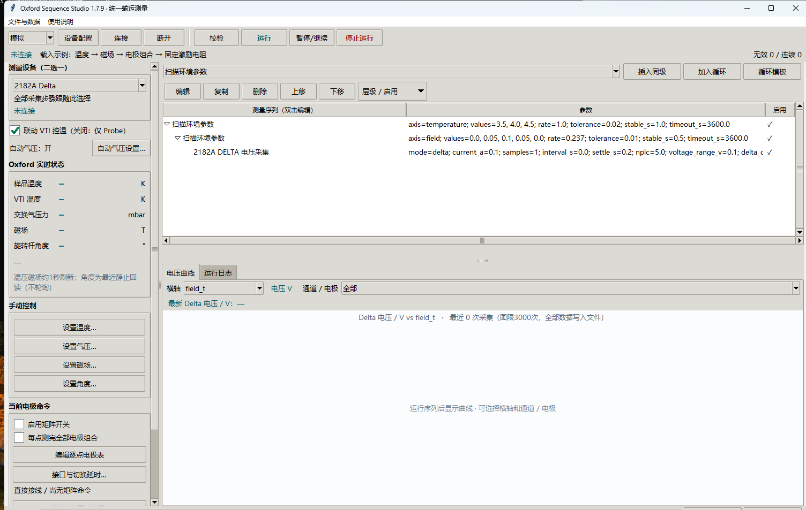

# Oxford Sequence Studio

**把低温输运测量的组合扫描，变成一份可复现的 JSON 序列。**

[](#快速开始)
[](#快速开始)
[](LICENSE)
[](#项目状态)

> **Oxford Sequence Studio** is a Python/Tkinter measurement sequencer for cryogenic transport and magnetoresistance measurements on an **Oxford Instruments TeslatronPT** system (*now Quantum Design Oxford*). Nested *temperature × magnetic field × rotator angle × electrode-set* sweeps are defined as a reproducible JSON sequence; the engine waits for each setpoint, switches electrode routes, acquires data point by point, and writes three cross-checkable outputs (`data.csv`, `events.jsonl`, `run.json`).
>
> **Self-contained** — no QCoDeS or PyMeasure dependency; the sequencer, GUI and instrument drivers all ship in this repository. Measurement backends: **Keithley 6221 + 2182A** (Delta mode) or **NI PXI-4462** four-channel digital lock-in. Instrument control over **VISA / GPIB / serial / TCP**: Oxford **iTC** and **iPS** Mercury controllers, relay matrix switching, rotator. Lab automation for physics instrumentation, with explicit safety limits for magnet ramping and current sourcing.

在 **Oxford Instruments TeslatronPT** 低温输运测量系统上，把「温度 × 磁场 × 角度 × 电极组」的组合扫描写成一份 JSON 序列，由引擎自动逐点等待到位、逐组切换电极、逐次采集电压，并同时产出三份可互相校验的数据文件。

> 一句话：**少记漏、少手抖、中途断了还知道丢在哪。**



<sub>模拟模式，载入内置示例序列：温度扫描 → 磁场扫描 → 2182A DELTA 电压采集。截图未连接任何仪器。</sub>

---

## 为什么需要它

在 TeslatronPT 上做输运测量，一次实验通常要沿多个环境轴扫描（温度、磁场、角度），每个环境点还要换多组四端电极接线，每次接线还要采一次电压。手工做这件事的风险是：忘记录当前温度、在励磁半程采数、换电极时电流还开着、中途断开后不知道哪一点丢了。

Oxford Sequence Studio 把这件事变成一份可保存、可复现的序列：

```
扫描温度 [3.5, 4.0, 4.5]
└── 扫描磁场 [0, 0.05, 0.10, 0.05, 0]
    └── 启动电流激励 → 逐组切换电极 → 采集电压
```

引擎负责逐点等到位、逐组切换电极、逐次采集，并同时写三份东西：

- `data.csv` —— 宽表，每点一行，给人看 / 给脚本读
- `events.jsonl` —— 逐次原始记录，可追溯、可恢复
- `run.json` —— 本次运行到底用了什么配置

---

## 主要特性

| 类别 | 支持 |
|---|---|
| **测量设备** | `2182A + 6221`（Delta 三点法，6221 主控）/ `PXI-4462 + 6221`（交流激励 + 四通道同步数字锁相）—— 二选一，全局唯一 |
| **环境轴** | 温度（Probe，可联动 VTI）、磁场（iPS）、角度（旋转杆）、气压（仅手动设定 + 自动气压管理） |
| **扫描** | 温度 / 磁场 / 角度的任意嵌套扫描；`repeat` 重复；`channels` 电极循环 |
| **电极** | 矩阵逐点遍历（每点测完全部组合）或显式 `route` / `channels` 节点；支持一口多 pin 并联 |
| **谐波** | 4462：1f 恒定采集 + 附加 **2f 或 3f**（每通道导出幅值 / X / Y） |
| **可靠性** | 逐点等待到位、环境通道分级、连续无效告警、无效测量写 `NULL` 继续、日志全程留痕 |
| **安全** | 运行失败或非正常结束时自动关源、磁场 HOLD；源顺从 / 过温等异常直接停止整轮 |

## 适用范围

这套程序是为**一台** TeslatronPT 台面写的。那条台面的测量链路是 `6221 + 2182A` 或 `6221 + PXI-4462`，没有接别的仪器。

下面这些设备**在这台台面上用不到**，所以没有实现：

| 未集成 | 说明 |
|---|---|
| SR830 锁相放大器 | 这台台面上没有分配 SR830；含 SR830 的旧方案文件不会被导入 |
| DC 测量 / I–V / 扫电流 / DCON / 非零直流偏置 | 本台面的测量走 Delta 三点法与交流锁相，不涉及这些模式 |
| 气压扫描（`sweep.axis='pressure'`） | 只做气压设定与自动气压管理，气压不作为扫描轴 |
| 2182A 与 4462 同时使用 | 一次运行对应一条测量链路 |
| PXI 采集期间切换矩阵 | 4462 是整段持续输出，采集过程中切继电器没有意义 |
| 程序退出后的断点恢复 | 等待状态只在内存中，关闭程序即丢失（已采集的数据文件保留） |

如果你的台面接线或设备组合不同，需要自己改；这些边界在代码里都有显式检查而不是静默降级，方便你定位到要动的分支。

---

## 快速开始

### 环境要求

- Windows（GUI 与仪器驱动基于 Windows 的 VISA / COM 环境）
- Python **3.11+**
- Tkinter（Python 官方安装包默认包含）

```powershell
git clone https://github.com/w125342201-rgb/oxford-sequence-studio.git
cd oxford-sequence-studio
pip install -r requirements.txt
```

### 模拟模式 —— 不接任何仪器，先把流程跑通

```powershell
python main.py
```

1. 左上角模式保持「模拟」，点「连接」
2. 已载入内置示例：温度扫描 → 磁场扫描 → 电压采集
3. 点「运行」，曲线与日志出现，`./data/` 下生成一个带时间戳的运行目录

不想开图形界面：

```powershell
python run_simulation.py examples/01_T_B_electrodes.json
```

### 真实硬件

1. 打开「设备配置」，填写三台 Oxford 仪的地址、启用 6221 / 矩阵 / 旋转杆，**核对实验限值**
2. 左侧「测量设备（二选一）」选设备（会同步到序列里的所有采集步骤）
3. 模式切「真实硬件」→「连接」→「校验」→「运行」

> 首次联机**务必**在空载或假样品上按 [docs/reference/09-测试与验证.md](docs/reference/09-%E6%B5%8B%E8%AF%95%E4%B8%8E%E9%AA%8C%E8%AF%81.md) 的验收边界逐项核对。

---

## ⚠️ 上机前必须改的两处

### 1. 仪器 IP 要换成你自己台面的

仓库里填的是原作者台面的地址（`192.168.1.113 / .114 / .115`），**换到你的台面必须换成你自己的**：

```python
'vti_host':   '192.168.1.113',   # iTC-VTI   控温仪
'probe_host': '192.168.1.114',   # iTC-Probe 样品杆控温仪
'ips_host':   '192.168.1.115',   # iPS       励磁电源
'port': 7020,
```

修改位置任选其一：

- `studio/model.py` 里的 `DEFAULT_CONFIG`（改默认值）
- 或直接在 GUI「设备配置」里改 —— 保存在方案 JSON 里，随方案走

另外需要按你的台面改的还有：6221 / 矩阵开关的 VISA 资源名（如 `GPIB0::14::INSTR`）、旋转杆串口号（如 `COM3`）、矩阵行号映射。详见 [docs/reference/03-硬件与接线.md](docs/reference/03-%E7%A1%AC%E4%BB%B6%E4%B8%8E%E6%8E%A5%E7%BA%BF.md)。

### 2. 实验限值在设备上限侧

新建步骤的默认工作点是**贴着设备上限**设的，这是原作者的使用习惯，不一定是你的：

| 项 | 默认 | 位置 |
|---|---|---|
| 励磁速率 | 0.237 T/min（本机上限） | `FIELD_MAX_RATE_T_PER_MIN` |
| 磁场稳定容差 | 0.01 T | `DEFAULT_FIELD_TOLERANCE_T` |
| 测量电流 | 0.1 A | `DEFAULT_SOURCE_CURRENT_A` |
| Compliance | 105 V | `SOURCE_MAX_COMPLIANCE_V` |
| 最大固定激励 | 0.105 A | `SOURCE_MAX_CURRENT_A` |

三条直接的物理后果（不是缺陷，是使用边界）：

1. **0.01 T 容差 vs 细步长**：底层 no-op 判据是 `max(0.012 T, 容差)`。步长 ≤ 10 mT 时，若电源没真正起励可能被判「已到位」。做细步长 MR 时**单独调小该磁场步骤的容差**（0.0002–0.001 T），不要改全局默认。
2. **0.1 A × 105 V = 10.5 W 会落在样品上**。Compliance 是限压不是限功率，建议按 `I × R_expected × 2` 设置。
3. **量程刻意未改**：2182A 仍 0.1 V 档（对应 R ≤ 1 Ω），4462 仍 ±316 mV 档（对应 R ≤ 3.16 Ω）。超出时在采集步骤里改档，否则整点 `NULL`。

---

## 支持的硬件

| 设备 | 型号 | 接口 |
|---|---|---|
| 恒温器控温 | Oxford Instruments iTC（VTI / Probe 两路） | 以太网 ISOBUS，端口 7020 |
| 磁体电源 | Oxford Instruments iPS | 以太网 ISOBUS，端口 7020 |
| 电流源 | Keithley 6221 | GPIB / VISA |
| 纳伏表 | Keithley 2182A | GPIB / VISA |
| 数据采集 | NI PXI-4462（4 通道同步 DSA） | PXI / `nidaqmx` |
| 矩阵开关 | 自建继电器矩阵（逐点切换电极） | 串口 / VISA |
| 旋转杆 | 角度控制（**无停止指令**，见下方状态说明） | 串口 |

---

## 数据输出

每次运行生成一个 `data/YYYYMMDD_HHMMSS_xxxxxxxx/` 目录：

| 文件 | 内容 |
|---|---|
| `data.csv` | 宽表，每环境点 / 每电极组合一行，51 / 63 / 28 列（随设备与选项变化） |
| `events.jsonl` | 逐条事件流：等待、设置、采集、异常、重试，带时间戳，可用来复原过程 |
| `run.json` | 本次运行的实际配置与契约（`pxi_contract`、`pxi_per_step_current` 等） |

字段定义见 [docs/reference/07-数据与文件格式.md](docs/reference/07-%E6%95%B0%E6%8D%AE%E4%B8%8E%E6%96%87%E4%BB%B6%E6%A0%BC%E5%BC%8F.md)。`sample_output/` 下有一份可直接打开看的样例。

---

## 目录结构

```
studio/        核心代码：GUI、序列模型、校验、执行引擎、仪器后端
tests/         unittest 回归（含仪器替身，不需要真机即可跑）
examples/      可直接运行的示例序列
docs/          文档三层：L0 开发规范 / L2 说明参考 / L3 历史归档
legacy/        早期各自独立的仪器脚本与驱动（TeslatronPT、6221+2182A、矩阵开关、PXI-4462、旋转杆）
audit/         历次审计的变更清单与源码比对记录
sample_output/ 一份样例输出
```

---

## 文档

| 想做什么 | 看哪里 |
|---|---|
| 第一次接手，了解全貌 | [docs/reference/01-项目概览.md](docs/reference/01-%E9%A1%B9%E7%9B%AE%E6%A6%82%E8%A7%88.md) → [02-架构与模块](docs/reference/02-%E6%9E%B6%E6%9E%84%E4%B8%8E%E6%A8%A1%E5%9D%97.md) |
| 接线、地址、仪器设置 | [docs/reference/03-硬件与接线.md](docs/reference/03-%E7%A1%AC%E4%BB%B6%E4%B8%8E%E6%8E%A5%E7%BA%BF.md) |
| 测量原理（Delta、锁相、谐波） | [docs/reference/04-测量原理.md](docs/reference/04-%E6%B5%8B%E9%87%8F%E5%8E%9F%E7%90%86.md) |
| 序列格式与校验规则 | [docs/reference/05-序列模型与校验.md](docs/reference/05-%E5%BA%8F%E5%88%97%E6%A8%A1%E5%9E%8B%E4%B8%8E%E6%A0%A1%E9%AA%8C.md) |
| 写数据处理脚本 | [docs/reference/07-数据与文件格式.md](docs/reference/07-%E6%95%B0%E6%8D%AE%E4%B8%8E%E6%96%87%E4%BB%B6%E6%A0%BC%E5%BC%8F.md) |
| 改代码 | **[docs/开发规范.md](docs/开发规范.md)**（唯一权威：边界、红线、决策台账） |
| 完整版本变更记录 | [README_使用说明.md](README_%E4%BD%BF%E7%94%A8%E8%AF%B4%E6%98%8E.md) |

文档索引：[docs/README.md](docs/README.md)

---

## 项目状态

这套程序已经在真实的 TeslatronPT 台面上长期使用，日常的温度 / 磁场 / 角度组合扫描流程稳定，目前没有已知的阻塞性问题。

同时把验证范围说清楚，避免误解：

- 验证方式是**长期实机使用**，而不是系统性的硬件验收测试（没有专门的电气时序、极限条件测试报告）。
- 4462 的 ADC / 滤波 / 线缆相移**未自动校准**，X/Y 使用保存的参考相位。
- AC 耦合（1.7.9 新增）各次谐波衰减与相移不同（13 Hz 基频下 1f 约 −3.25% / +14.7°），需按基频标定后才能比较 2f/1f、3f/1f。
- Delta 的电阻换算固定 `V/I`，历史上「再除 2」的争议见 [04-测量原理](docs/reference/04-%E6%B5%8B%E9%87%8F%E5%8E%9F%E7%90%86.md)。
- 旋转杆协议**没有停止指令**，「停止」只保证不再发新命令。
- 程序退出**不会**自动升温、退磁或解除矩阵；强杀 / 掉电可能让 6221 保持输出。
- 不宣称与 SR830 等效精度。

换一台设备、换一个样品体系时，这些边界值得重新核对一遍。

---

## ⚠️ 安全声明

本项目直接控制**强磁场电源、大电流源和低温恒温器**。误用可能损坏设备、损坏样品，或造成人身伤害。

- 磁场、电流、电压限制**必须**按你自己的设备和样品重新核对，不要沿用仓库里的默认值
- 首次联机务必在空载或假样品上跑通全流程，并确认急停 / 断电行为
- 换电极接线前确认电流源已关闭
- 强磁场区域内的铁磁物品、心脏起搏器等风险与本项目无关，但你在操作时仍需自行遵守实验室安全规程

作者不对任何设备损坏、数据损失或人身伤害承担责任。代码按 MIT 协议「原样」提供，不附带任何明示或暗示的担保。

---

## 许可

[MIT](LICENSE)

如果这套东西帮你省了几天写脚本的时间，欢迎提 Issue 说说你怎么用的、哪里不顺手。
